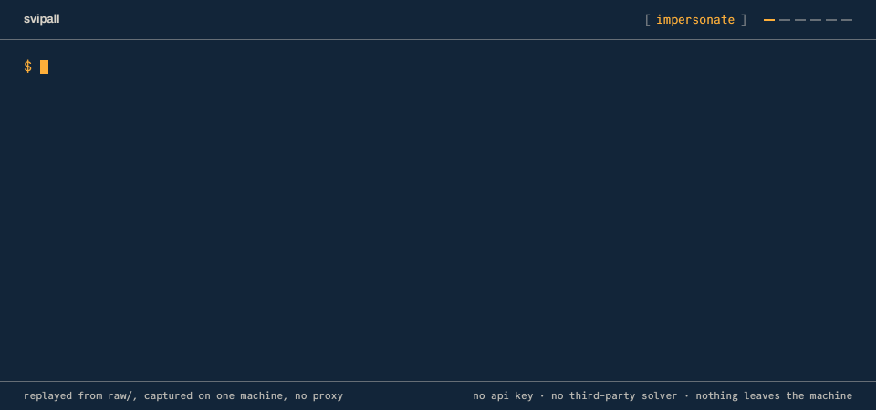

<p align="center">
  <picture>
    <source media="(prefers-color-scheme: dark)" srcset="assets/brand/svipall-hero-dark.gif">
    
  </picture>
</p>

<h3 align="center">A different face at every gate.</h3>

<p align="center">
  <b>Web reading for your AI agent, running on your own machine.</b><br>
  An MCP server and CLI, in Rust, that extracts web pages into Markdown,<br>
  crawls sites within configured limits, searches without an API key,<br>
  and attempts supported challenges, then says plainly which ones it could not.
</p>

<p align="center">
  <a href="https://www.rust-lang.org"></a>
  <a href="#license"></a>
  <a href="#mcp-tools"></a>
  <a href="docs/development.md"></a>
  <a href="docs/proof.md"></a>
  <a href="docs/privacy.md"></a>
</p>

<p align="center">
  <a href="#install"><b>Install</b></a> &middot;
  <a href="#what-you-can-actually-do-with-it"><b>Use cases</b></a> &middot;
  <a href="docs/proof.md"><b>Proof</b></a> &middot;
  <a href="#mcp-tools"><b>Tools</b></a> &middot;
  <a href="docs/captcha.md"><b>Captcha</b></a> &middot;
  <a href="#the-rest-api"><b>REST API</b></a> &middot;
  <a href="#how-svipall-compares"><b>Compare</b></a> &middot;
  <a href="docs/faq.md"><b>FAQ</b></a>
</p>

<p align="center">
  <a href="docs/demo/"></a><br>
  <sub>Replayed from real runs on one machine. <a href="docs/demo/">How it was recorded, and the raw captures</a>.</sub>
</p>

---

**Everything runs locally. There are no third-party API keys, no paid captcha services and no
telemetry.**
Web requests reach the sites you visit, and results reach the agent or client you connect.

Svipall fetches and renders pages locally, extracts their content, and reports detected challenges
and extraction-quality labels. Some sites still block it, and an apparently successful response
can contain incomplete records or a page shell. The published comparisons therefore audit useful
content separately from HTTP status and the tool's own verdict.

## Why Svipall

| What goes wrong | Svipall |
|---|---|
| Your agent reads a "checking your browser" screen and summarises it as the article. It was a `200`, so nothing flagged it | Twelve wall kinds, each naming the move it implies. Detected blocks carry an explicit verdict; classification is heuristic [details](docs/features.md#judging-what-came-back) |
| You crawl 5,000 pages and can't tell which are worth keeping | Assessed pages carry quality and duplicate observations, and quality labels never discard a page [details](docs/features.md#judging-what-came-back) |
| One page = 300,000 tokens of raw HTML. The fixes are four manual jobs you now own | Clean Markdown by default; opt into tables as rows, `out_file` to disk, or capture of the site's own JSON API [details](docs/features.md#reading) |
| You want to attempt a supported captcha without a paid solver | Fifteen widget families and eleven answer modalities, all local, optional vision models depending on the build, and a human dashboard for unresolved challenges [details](docs/captcha.md) |

It records successful visits, failures, incomplete extraction and rejected changes. Historical
benchmark logs and the current comparison use different scoring rules and configurations;
the [results section](docs/proof.md) distinguishes them.

Rust · MCP + CLI + REST · no Node, no Python, no API key · local storage and processing

**[Install it](#install)**

The [comparison table](#how-svipall-compares) describes other projects' documented scope.


---

## Install

Every channel below installs the latest [release](https://github.com/ilien-dev/svipall/releases),
built from the tree this README describes. `svipall doctor` reports what an installed build can do
on the machine it is on.

The [README factual audit](https://github.com/ilien-dev/svipall/blob/a4d76a31cf692e38dc356073df5d038310f1fa4b/bench/experiments/native-auto-candidate2-20260907/readme-factual-audit.md)
records the source checks, documentation corrections and limits of this review.

Choose agent-assisted setup, the Claude Code plugin, or a manual installation.

### Ask the agent you already have

Paste this into Claude Code, Cursor, Codex, opencode, or anything else that can run a command:

```
Install and configure Svipall by following the instructions here:
https://raw.githubusercontent.com/ilien-dev/svipall/main/docs/install.md
```

That page guides an agent through platform detection and verification, then asks which integration
you want: **CLI + Skill** (recommended, lower context use) or **MCP + Skill** (the full MCP tool
surface). It also asks whether to configure every project or only the current one, and verifies the
chosen result instead of treating a skill as MCP registration. When Svipall already exists, it
shows the installed and latest versions and asks whether to update the shared user installation or
keep the current version before it writes the integration. Completion depends on the agent, client
configuration and available permissions.

### Claude Code: install the plugin

```
/plugin marketplace add ilien-dev/svipall
/plugin install svipall@svipall
/svipall:setup
```

`/svipall:setup` installs the binary if it is missing, checks the server answers, and offers to make
Svipall the way Claude reaches the web in every project. It asks before each of those.
`/svipall:doctor` reports the installation's capabilities. `/svipall:update` shows the installed
and latest releases, then updates the binaries only if you choose to. `/svipall:uninstall` offers
removal of setup's registration, memory and strict-mode changes. Removing the binary and the data
are separate choices.

### Install it yourself

One line, with no toolchain and nothing to compile:

```bash
curl -fsSL https://raw.githubusercontent.com/ilien-dev/svipall/main/install.sh | sh   # macOS, Linux
irm https://raw.githubusercontent.com/ilien-dev/svipall/main/install.ps1 | iex        # Windows
```

Or a package manager, or the container image:

```bash
brew install ilien-dev/svipall/svipall               # macOS, Linux
scoop bucket add svipall https://github.com/ilien-dev/scoop-svipall && scoop install svipall
docker pull ghcr.io/ilien-dev/svipall:latest         # or :slim, the http tier only; see container notes
npx --yes svipall doctor                             # if node is already there
cargo install svipall                            # from source; add `svipall models install` for the models
```

The installers verify checksums where they can, and a mismatch stops the install. A missing
checksum file, entry or hashing utility only warns, so a successful exit is not by itself proof
the archive was verified: read the output. If the destination already contains another version,
the installer states that the binaries are shared by every harness and asks before replacing them.

When a newer release exists, Svipall says so once per session. One command updates both
binaries with the channel that installed them and refreshes the skills you copied by hand:

```bash
svipall update                 # --check only compares versions
```

Then close every session that uses Svipall and open it again. An agent can do the same from
[docs/update.md](docs/update.md).

Platform builds, what ships where, building from source and wiring it into any MCP client are all
in [docs/install.md](docs/install.md). If you have never installed anything from a terminal,
[GET-STARTED.md](GET-STARTED.md) is this section with nothing assumed.

### Then ask for something

There is no key to paste and no account to create.

> *"Read this page and summarise the pricing."*
> *"Crawl these docs and write me an `llms.txt`."*
> *"Watch this listing and tell me when the price moves."*
> *"Get me every row of that table as CSV."*

The assistant can choose among the exposed tools. Supported challenges that need a pair of eyes
go to a human dashboard at `http://localhost:8787/human`.

### Or drive it from a shell

```bash
svipall fetch https://example.com/article
svipall fetch https://shop.example/item --query "shipping costs"
svipall fetch https://docs.example/api --schema auto        # rows from a listing you've never seen
svipall crawl https://docs.example/ --pages 50 --out pages.csv
svipall search "rust async runtime" --engine all
svipall snapshot https://news.ycombinator.com                # the page as roles and refs, not markup
svipall serve --port 8788                                    # the same server as a local REST API
```

Completed data commands print **one JSON object** to stdout and diagnostics to stderr, so the
output can be piped to `jq`. `serve` is a long-running server, and help is written to stderr.

### What comes back

A historical run of `svipall fetch https://example.com`, with the `content` string cut short.
Current automatic fetches also report `identity_used`, and the fallback fields described below when
they have something to report. Over MCP, a page that simply arrived leaves out a single-entry
`attempts`, `chars` and an `identity_used` of `emulated`; the CLI and the REST API print them all:

```json
{
  "attempts": ["http: 200 (170ms) OK"],
  "chars": 167,
  "content": "# Example Domain\n\nThis domain is for use in documentation examples…",
  "final_url": "https://example.com/",
  "optimization": "ordinary",
  "quality": "thin",
  "quality_reasons": ["thin_text"],
  "status": 200,
  "tier_used": "http",
  "title": "Example Domain",
  "tokens_estimated": 42,
  "url": "https://example.com"
}
```

`tier_used` says how hard it had to try and `quality` says what actually arrived. When a page does
not arrive, the same object carries `blocked_reason`, `wall_kind`, `wall_vendor`, `wall_evidence`
and a `note` telling your agent what to do next. Straight from a committed benchmark record:

```json
{ "wall_kind": "vendor", "wall_vendor": "kpsdk.io", "wall_evidence": "header x-kpsdk-ct" }
```

A detected block carries a verdict alongside the returned content. A clear verdict still needs a
content check, because the classifier cannot show that the requested records arrived intact.

## What you can actually do with it

| You want to… | It looks like this |
|---|---|
| Read one page cleanly | `web_fetch` → Markdown with heuristic boilerplate removal and sanitization; `query=` ranks text by lexical relevance |
| Turn a listing into rows | `schema: "auto"` reads the page's own repeated structure, names the columns and hands back typed rows, with no model and no API call, in one parse |
| Pull a data table | `tables=true` → typed rows; `out_file: rows.csv` writes them to disk so thousands of rows never touch your context |
| Read what a video says | `web_video` → captions and chapters as one `[m:ss]` timeline, from a watch page, a page that embeds a player, `<video>` tracks or the stream manifest |
| See what a video shows | `web_video` → contact sheets of the whole video with the time on every cell, then `start`/`end`, `at`, `crop` and `query` to look closer |
| Skip the scraping entirely | `web_capture` returns the JSON the page fetched while loading, usually the site's real API, with `?page=2` waiting for you |
| Turn a docs site into a corpus | `web_crawl` with `llms.txt` output, near-duplicate labels, resumable frontier and lexical saturation stopping, subject to page/token/traffic limits |
| Search without a key | `web_search` scrapes DuckDuckGo, Bing and Brave; `engine="all"` merges them by agreement. An empty answer says which engines were blocked and what to try next |
| Read a JSON API | The JSON comes back as the server sent it, and `json_path: "items[:5].{name, id}"` keeps only the fields you name |
| Download a file | `out_file: "pkg.tar.bz2"` writes the bytes as served, with their size and `sha256`; a cut transfer resumes on the next call |
| Check that URLs exist | `web_fetch` with `urls` and `probe=true` returns status, final URL, type and length for each, without reading the bodies |
| Read a GitHub repo, issue or PR | `web_fetch` on the github.com URL answers from GitHub's API: the README and tree, a file's raw lines, a thread with every comment |
| Let the agent click things | `web_view` (roles + refs, a fraction of the tokens) then `browser` to click, type, scroll and wait, all through human-like input |
| Attempt a browser challenge | Automatic routing can escalate to a patient browser tier; unresolved challenges and detected blocks are reported, but the remote cause is not always identifiable |
| Attempt a captcha locally | Fifteen widget families and eleven answer modalities, model support where available and a phone-friendly human dashboard. No paid solver; local budgets and remote restrictions still apply |
| Log in once and stay in | `web_setup` with `do=login` opens a real window; you sign in; the cookies are kept in a profile you can export |
| Watch a page | `web_watch` checks the whole page or one CSS region while the server runs; saved selector fingerprints can help recover some redesigns |
| Read PDFs and Office files | docx, xlsx, pptx, odt, epub, rtf, csv and pdf come back as Markdown, from the web or from `file://` |
| Drive it from any language | `svipall serve` → 21 local REST routes, one per operation, behind a bearer key it generates for you |

### Who it is for

| You are… | Svipall gives you… |
|---|---|
| A Claude Code, Claude Desktop or Cursor user | One line of setup and tools your assistant picks by itself. Research, documentation, price comparison, monitoring |
| A developer building AI agents | A local web layer with structured output, token budgets, file export and resumable crawls; live web outcomes remain variable |
| A RAG or dataset builder | Bounded site crawls to Markdown, near-duplicate labels, `llms.txt`, and quality observations for assessed pages |
| A data or research person | Pages that sit behind "checking your browser" walls, and an honest answer when your address cannot open one |
| A privacy-conscious operator | No scraping API, no captcha farm, no geolocation lookup, no update check, no telemetry. Additional downloads are the managed browser when needed (automatic provisioning can be disabled) and the blocklists you enabled |
| A security or QA engineer testing your own site | A reproducible benchmark whose raw run logs are committed in this repository, and a request log that names which tier answered and which wall appeared |

Svipall runs on your own hardware. If you want a URL you can `curl` from a serverless function,
use a hosted scraping service instead. If you want the web inside your own agent, Svipall does that
processing locally; browser traffic and optional downloads are described under
[Privacy and safety](docs/privacy.md).

---

## How it works, in plain words

*The steps below describe the emulated tiers. The current automatic policy can promote a supported
emulated route and append one eligible native fallback. Wall verdicts can end the attempt.
Content-quality labels alone do not trigger escalation.*

1. Ask for the page through HTTP first on a new route. The default engine emulates selected
   Chrome network characteristics. In the historical `public31` runs above, 59 of 93 cells stopped at this tier, and
   44 of those scored `ok` under that benchmark's rule. A route that stops here has still not
   necessarily delivered the page.
2. If the page needs JavaScript, open a browser. Headless Chromium runs the scripts and hands
   back the rendered document.
3. If the site checks for robots, wear a disguise. The stealth tier patches known browser
   surfaces to match the emulated identity. The offline probes check those surfaces; they cannot
   prove that an arbitrary detector will accept them.
4. If the site wants a real person, act like one. The `real` tier is a visible-but-offscreen
   browser with a persistent profile. It moves the pointer along curves and scrolls with a wheel.
5. If there is a challenge, answer it or wait it out. The `warm` tier runs the captcha strategy
   loop during its bounded wait and avoids pointer activity on recognized self-verifying
   interstitials. This does not guarantee clearance.
6. Use native only as a last resort. When eligible and within the remaining budgets, try one
   native browser attempt. It exposes real device characteristics and reports a privacy notice.
7. Remember what worked. Two supporting observations can promote a useful emulated route for
   later visits in the same context. Native stays last even when it succeeds.
8. Report the observed failure. Where available, a blocked result includes `blocked_reason`,
   the classified wall, recognized vendor/evidence and a suggested next step. Classification is
   heuristic. Transport errors and local budget deferrals may have less page evidence.

---

## MCP tools

Twelve tools, all local. Up to 1.4 there were thirty-one, one per operation. An operation that had
its own tool is now a mode of one of the twelve, chosen by an argument.

| Tool | Called with | What it does |
|---|---|---|
| `web_fetch` | `url` | Fetch a page as Markdown or structured JSON. `mode=auto` climbs the ladder. `schema` (self-healing), `tables`, `scroll`, `query`, `max_tokens`/`cursor`, `json_path`, `wait`, `fresh`, `cache`, `include_metadata`, `include_links`, `include_quality`, `use_site_template`, `robots`, `out_file`, `mobile`, `text_only`, `isolated`, `css_selector`, `profile`, `proxy`, `method`/`body`/`headers`. URLs may be `raw:<html>` or `file://` under `local_roots`. JSON, plain text and source files come back as served; a binary body goes to `out_file` as bytes; github.com URLs are read from the API |
| `web_fetch` | `urls` | Bounded-parallel fetch of many URLs, results in input order. Every per-page argument of a single fetch applies to each page. The whole answer is held to `max_tokens_total` (8000 by default), a cut page carries a `cursor` to pass back with its `url`, and `out_dir` writes every page whole. Reports `corroboration` (how many *distinct* documents the set actually is) and marks each duplicate with `same_text_as` |
| `web_fetch` | `urls` (or `url`) + `probe=true` | Status, `exists`, final URL, content type and length for each URL, and whether each name resolves. Stops at the headers. A 404 is an answer here |
| `web_search` | `query` | DuckDuckGo / Bing / Brave without an API key; `engine="all"` merges by agreement, `lang` and `region` set the locale. Every engine's outcome is in `attempts` (left out when the first engine asked found results), a failing engine is rested and remembered, and a zero-result answer carries a `note` on what was blocked and what to try |
| `web_search` | `query` + `site` | Find a site's search through its OpenSearch description, its search box (also one opened by an icon or inside a shadow root) or a known platform endpoint, and learn the query-URL pattern. `found: false` lists what was tried |
| `web_crawl` | `url` | Same-domain crawl with robots.txt, dedup, boilerplate removal, `strategy=dfs`, `scroll`, `schema`/`tables` for rows, `llms.txt`, file export, a saturation stop, and a `crawl_id` to resume |
| `web_crawl` | `url` + `map=true` | A site's URLs without crawling it: robots.txt, sitemaps (nested indexes and `.gz` included), `llms.txt`, RSS/Atom feeds and homepage links, a few hundred tokens of structure instead of the thousands a crawl costs. `sources_used` names only the sources that gave URLs |
| `web_view` | `url` | The page as roles, accessible names and short refs that `browser` accepts. Deterministic, no vision model |
| `web_view` | `url` + `image=true` | PNG of the rendered page, `full_page` or `mobile` |
| `browser` | `url` + `actions` | One shot: click, type, fill, press, hover, select, scroll, wait, eval, goto, screenshot, hold, verify, console; supported pointer/keyboard/wheel actions use the behavior layer, while `eval` runs caller-supplied JavaScript |
| `browser` | `open=true`, then `session_id`, then `session_id` + `close=true` | Persistent session with cookies and page state across calls. `open=true` may carry the first `url` and `actions`, and then returns the `session_id` together with that step's result. When the page cannot be read after the actions, a session step keeps their results and gives the cause in `content_error` |
| `web_watch` | `action=add` (default), `list`, `check`, `remove` | Persist a watch and check it while the server runs; list or check to retrieve changes. Region recovery after a redesign is heuristic |
| `web_watch` | `action=diff` | What changed on a page since Svipall last saw it |
| `web_status` | no argument, `sections`, or a reset | A short summary by default: cooldowns, server holds, visit limits, identity, browser, solver. `sections` adds learned tiers, routes, per-exit health and latency, reputation, HTTP/3, cache, crawls, profiles and models. `clear_cooldown`, `forget_tier`, `clear_budget` and `clear_cache` answer only with what they cleared |
| `web_status` | `log=summary` or `log=recent` | Which tier answered, which wall appeared, how long it took, per domain |
| `web_setup` | `do=login` | Visible window for a manual login or challenge; cookies saved to a profile |
| `web_setup` | `do=route` | Per-domain proxy, or a pool of `proxies` with `countries`; subdomains inherit; `exit_strategy` sticky or round-robin; `check=true` tests the exits (liveness, latency, DNS leak) with no third-party service |
| `web_setup` | `do=profile` | Export/import an encrypted browser profile between machines |
| `web_setup` | `do=browser` | Download or manage Chrome for Testing. The managed copy also updates itself in the background once it is two majors behind stable (`browser_auto_update`) |
| `captcha` | `url` | Attempt a captcha on the blocked page and return the resulting content or unresolved state |
| `captcha` | `kind` + `sitekey` + `page_url`, `image`, or `task_id` (+ `good`) | Local captcha attempts: a token for `turnstile`, `recaptcha_v2` or `hcaptcha`, the text in an image, a pending task polled, and a report of whether the site took the answer. The dashboard also exposes `in.php` / `res.php` / `createTask` / `getTaskResult` compatibility endpoints for supported tasks. This is not full compatibility with every solver-client option |
| `web_capture` | `url` | Observe matching JSON/network responses during a bounded browser visit; API usability and completeness are not guaranteed |
| `web_video` | `url` | A video's captions (a person's first, else the platform's automatic ones, in `lang` when asked) and chapters as one timeline. Reads a known player's boot JSON, JSON-LD `VideoObject`, `<track>`, and HLS/DASH caption renditions; a player whose caption addresses only answer its own requests is read through a borrowed request in a live page. A plain call also writes contact sheets of the whole video, built from the player's own seek-bar thumbnails: sixteen moments a sheet, the time in the corner of each cell, and what each sheet costs to read. `start`/`end` capture frames spread over that part (`frames` sets how many, up to 120; left out, the number follows the length, and doubles when nothing is said), `at` captures exact moments, and `crop` returns a part of the frame at the video's own resolution, which is how small text gets read. `query` returns the moments where something is said, written on screen or shown. Pictures are files on disk, named in the answer, and a second call reuses the frames of the first. Each frame is read from the page's own `<video>` element, so the player's controls and captions are not in it; a file from another origin that forbids this gets a screenshot instead, and the notes say so. An advert that plays first is run through, muted, before any frame is taken. A video with no captions and a media file behind it is transcribed on this machine when the speech model is installed (`svipall models install`). Encrypted streams are reported as `drm` and never read, so they get no frames |
| `web_notes` | `action=get` (default), `set`, `list`, `delete` | Key-value memory that outlives the session |

The 1.x names (`web_fetch_many`, `web_snapshot`, `solve_and_continue` and the rest) are no longer
listed, but each still answers when called by name with its 1.x arguments. The 2.0.0 entry of the
[changelog](CHANGELOG.md) maps every one of them to its 2.0 call. The CLI commands and the REST
routes did not change: they stay one per operation.

Every tool refuses a parameter it does not have, and names the closest real one, so a limit the
caller thinks it set is never silently ignored. An argument the chosen mode has no use for, such as
`find` with `image=true`, refuses the call too and names what that mode takes. Numbers and booleans
may arrive as strings.

### Visits, and waiting for one

Visits are limited per host and exit: 12 a minute by default, shared by every session, subagent
and process on the machine, since they all leave from the same address. One fetch counts once
however many tiers it climbs. When the window is full the fetch waits for the next free slot if
that fits in half its timeout, and `wait` (up to 900 seconds) lets it wait longer. Otherwise it is
refused with `blocked_reason: "visit_limit"` and the seconds left, and reading the same thing from
another host is the other way out. A server's `Retry-After` is honoured as given. A 429 without one
backs off for 30 seconds at first, and for 15 minutes only after repeated strikes.
`web_status(clear_cooldown=…)` clears all of it for one domain. The figures are in
[Configuration](docs/configuration.md).

### GitHub

A github.com URL is read from GitHub's REST API, or from its raw file host for a file, rather than
from the page the browser would build. A repository gives its facts, top-level tree and README.
`blob/…#L10-L20` gives those lines of the raw file. An issue or pull request gives the body and
every comment and review in order, with author, date and reactions, and releases and commits are
mapped the same way. Discussions, gists, wikis and lists still read as the page. Without a token
the API allows 60 requests an hour. A `GITHUB_TOKEN` in `~/.svipall/secrets.env` raises that and is
sent to `api.github.com` only. A rate limit is reported with the time it lifts, never as a wall.

To find code across GitHub repositories, prefer the searchGitHub tool of the grep.app MCP server when this session has it: it is integrated with GitHub natively. Svipall still reads a known repo, file, issue, PR or release, and does all of it when that tool is absent.

### The CLI

```
svipall fetch | crawl | probe | snapshot | capture | video | search | map | log | notes | watch
        profile | browser | route | status | serve | doctor | update | hook
        config show | set | preset
        solver export-corpus
        quality ask | export-training | train
```

`svipall <command> --help` prints one command's flags, and a flag the command does not take is an
error that names the nearest one. A test asserts the usage text names every command the binary answers to, and a second test keeps
[`skill/SKILL.md`](skill/SKILL.md) in step with both.

---

## The REST API

The same server, over HTTP, so any language can drive it without an MCP client or a shell.

```bash
svipall serve --port 8788        # the bearer key is printed once, and kept in ~/.svipall/api_key
curl -sH "Authorization: Bearer $KEY" -H 'content-type: application/json' \
     -d '{"url":"https://example.com","query":"pricing"}' localhost:8788/v1/fetch
```

`svipall-mcp` mounts the same router when `rest_port` is set, on its own listener, and shares its
browser pools, page cache and route evidence with the MCP tools.

Twenty-one routes, one per operation, each taking that operation's own JSON as the body:

| | |
|---|---|
| `POST /v1/fetch` `/v1/fetch_many` `/v1/crawl` `/v1/probe` `/v1/video` | pages |
| `POST /v1/search` `/v1/site_search` `/v1/map` | finding things |
| `POST /v1/snapshot` `/v1/act` `/v1/capture` `/v1/screenshot` | a real browser |
| `POST /v1/solve_and_continue` | the captcha, answered on the blocked page |
| `POST /v1/diff` `/v1/watch` `/v1/notes` `/v1/log` | memory |
| `POST /v1/route` `/v1/profile` `/v1/browser_setup` | configuration |
| `GET`/`POST /v1/status` | what this installation has learned; `GET /v1/status?sections=holds,tiers` for more than the summary. `GET` is read-only by construction: the clearing fields are reachable only by `POST` |
| `GET /v1/health` | the one route with no key, so a container healthcheck does not need one |

A blocked page is a `200`: the call ran, the *page* did not. `blocked_reason`, `wall_kind` and
`note` can appear in the body as over MCP. Non-2xx responses include a malformed body or an unknown parameter (`400`), a bad key
(`401`), a browser `Origin` or a rebound `Host` (`403`), a body over 2 MB (`413`) or a broken
installation (`500`). An unknown job can return `404`, and routing can reject unsupported paths
or methods. A client must inspect both the HTTP status and the tool result before deciding to retry.

Every operation and job route needs the key, including on loopback. Only `/v1/health` is exempt.
A local port is not a boundary on its own: Svipall carries logged-in profiles, cookies and your
exit address, so anything that reaches the port can make requests as you.
Two more checks sit in front of the key, because binding to `127.0.0.1` does not stop a page in your
own browser being served a DNS answer of `127.0.0.1` and posting to it: any request carrying an
`Origin` header is refused, and on a loopback bind so is any `Host` that is not loopback. There is no
CORS layer and there will not be one, because no browser page is a client of this API.

Ten operations are deliberately **not** routes, in three groups, and `rest.rs` records why next to
each. A browser session (`browser` with `open=true`, `session_id` or `close=true` over MCP) has a
persistent lifecycle that is outside this REST interface's current design. The login window
(`web_setup` with `do=login`) is interactive and is excluded too. The six token, image and task
operations (`captcha` with `kind`, `image` or `task_id`) already answer on the dashboard port in the
classic solver wire shape. Thirty-one operations minus those ten is the twenty-one routes above. A new
`#[tool]` fails the test suite until it is listed as a route or as a named exclusion.

A long crawl runs as a job and does not hold the connection. `"async": true` answers `202` with an id. `GET
/v1/jobs/{id}` polls it, `GET /v1/jobs/{id}/stream` follows it as Server-Sent Events, `DELETE` stops
it. The id is the `crawl_id`, so there is one handle to learn and resuming is `{"crawl_id": "…"}`,
the same word the MCP tool and the CLI already use. A cancelled crawl stops between pages *after*
that page's links are queued, so its frontier is kept. It is never aborted, because that would leak a
browser page. A job whose process was killed becomes `interrupted`, and `interrupted` is resumable.
The first frame of a stream is always a snapshot from the store, so a subscriber that joins at page
forty is never told the job started at zero. And a queued job whose site already has one running is
held back: two crawls of one site would spend one address's reputation with that host twice as fast,
which is the scarcest thing a local-only tool has. Full contract in [`docs/rest.md`](docs/rest.md).

---

## How Svipall compares

The following describes project scope from primary documentation checked on 2026-09-07.
It is not a feature-exhaustive comparison or a head-to-head performance test.

| Project | Documented focus |
|---|---|
| Svipall | Local Rust CLI, MCP and REST server; bounded automatic routing, content labels and local challenge attempts with human fallback |
| [Firecrawl](https://github.com/firecrawl/firecrawl) | Web scraping/crawling API with hosted and self-hosted options; the open-source and cloud offerings differ |
| [Crawl4AI](https://github.com/unclecode/crawl4ai) | Python crawler with browser extraction and a Docker server offering API and MCP access |
| [Scrapling](https://github.com/D4Vinci/Scrapling) | Python adaptive parsing, fetchers and spiders, with session/proxy controls and MCP integration |
| [Playwright MCP](https://github.com/microsoft/playwright-mcp) | Browser automation through MCP using structured accessibility snapshots |

The historical benchmark above does not establish current superiority over these
projects. Choose based on your required integration and validate your own target pages.

---

## Everything else

This file is the short version. Everything it leaves out is in the documents below.

| | |
|---|---|
| [Install](docs/install.md) | Every platform, what ships where, building from source, wiring it into any MCP client |
| [Proof](docs/proof.md) | Every published number, with the command and the log that reproduce it, failures included |
| [Features](docs/features.md) | The whole surface, tool by tool |
| [Captcha](docs/captcha.md) | Fifteen widget families, eleven answer modalities, and what happens when none of them work |
| [Configuration](docs/configuration.md) | Every key in `~/.svipall`, and what changing it costs |
| [The REST API](docs/rest.md) | Nineteen routes, the job routes, and what a status code means |
| [Extraction](docs/extraction.md) | How a page becomes Markdown, and how well, measured against three corpora |
| [Privacy and safety](docs/privacy.md) | What leaves this machine, and what does not |
| [Limits](docs/limits.md) | Stated on purpose |
| [Architecture](docs/architecture.md) | The crates, and why they are separate |
| [Development](docs/development.md) | Building, testing, and the benchmarks |
| [FAQ](docs/faq.md) | |
| [Exit codes](docs/exits.md) | What the binary returns, for scripts |
| [Models](docs/models.md) | The embedded weights, their licences and their sizes |
| [Firefox](docs/firefox.md) &middot; [HTTP/3](docs/http3.md) &middot; [Benchmarks](docs/bench.md) | The engineering notes |
| [Changelog](CHANGELOG.md) &middot; [Contributing](CONTRIBUTING.md) &middot; [CLA](CLA.md) &middot; [Disclaimer](DISCLAIMER.md) | |

## About the name

**Svipall** is one of Odin's names in *Grímnismál*, stanza 47. Bellows renders it as
"The Changing" in his [translation notes](https://en.wikisource.org/wiki/The_Poetic_Edda_%28tr._Bellows%29/Grimnismol).
The project uses that name as an image of changing appearance, not as a promise of invisibility.

That is the idea behind its emulated identities: keep the machine, browser, network fingerprint
and input behaviour coherent within a session, and retire sessions when they are refused.
Native fallback instead uses real browser/device characteristics. Neither policy guarantees that
a site will accept the visit or be unable to link it to an earlier one.

---

## License

**AGPL-3.0-only**, subject to the terms in [`LICENSE`](LICENSE), including its conditions for
distribution and section 13 on remote network interaction. The component licences and linking
exception below also apply. This paragraph is not a substitute for those terms.

`crates/svipall-extract`, the extraction engine, is deliberately **MIT OR Apache-2.0** so that a
project under any licence can depend on it. `crates/svipall-cdp` keeps its upstream terms
(chromiumoxide, MIT OR Apache-2.0) and `crates/svipall-quic` keeps its own (quiche, BSD-2-Clause). The default build links BoringSSL under an explicit AGPL section 7 linking
exception. These are set out in [`NOTICE`](NOTICE) and
[`THIRD-PARTY-NOTICES.md`](THIRD-PARTY-NOTICES.md).

Contributions are taken under [`CLA.md`](CLA.md): contributors keep the copyright in their work and
grant the maintainer a licence broad enough to also release it under other terms. The public
release stays AGPL-3.0-only. For a licence other than the AGPL, write to <code@ilien.dev>.

## Trademark

The name **Svipall** and the Svipall logo are trademarks of the author. They are **not** licensed
under the AGPL, and nothing in this repository grants a licence to them.

The licence gives you the code. It does not give you the name. Run it, study it, modify it, fork it
and redistribute it freely under the AGPL. Distribute a modified version under a different name
and without the logo, so that nobody who downloads it is misled about who produced it or what is
in it.

The project permits descriptive references such as saying that your project uses Svipall,
works with Svipall, or is a fork of Svipall, without implying endorsement.

## Disclaimer

Svipall is provided **as is, with no warranty and no liability**, and it grants you **no
authorisation with respect to any system you point it at**. Complying with the law, with
data-protection rules and with a site's terms is the operator's responsibility, not the author's.
Read [`DISCLAIMER.md`](DISCLAIMER.md) before you run it against something that is not yours.

---

<p align="center">
  <sub>
    <b>Keywords:</b> web scraping · web crawler · MCP server · Model Context Protocol · Claude Code ·
    Claude Desktop · Cursor · AI agent tools · LLM web browsing · LLM-ready markdown ·
    html to markdown · RAG data pipeline · anti-bot bypass · Cloudflare bypass · Turnstile · Akamai ·
    PerimeterX · DataDome · Kasada · captcha solver · local captcha solving · headless browser ·
    stealth browser · browser fingerprint · TLS fingerprint JA4 · Chrome impersonation · HTTP/3 QUIC ·
    proxy rotation · Rust · Playwright alternative · Firecrawl alternative · Crawl4AI alternative ·
    Scrapling alternative · local-first · self-hosted · privacy · no API key
  </sub>
</p>
