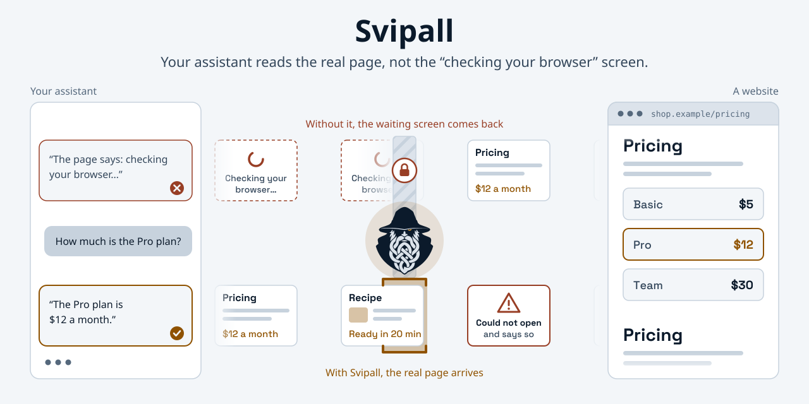

<p align="center"><picture>
  <source media="(prefers-color-scheme: dark)" srcset="assets/hero-dark.svg">
  
</picture></p>

<h1 align="center">Svipall: a better web reader for your AI app</h1>

<p align="center"><b>The pages your AI's own web search cannot open, read from your own computer.</b></p>

<p align="center">
  <a href="LICENSE"></a>
  <a href="docs/privacy.md"></a>
  <a href="docs/install.md"></a>
</p>

<p align="center">
  <a href="https://svipall.ilien.dev">Website</a> ·
  <a href="#what-your-ai-can-do-with-it">What it does</a> ·
  <a href="#how-it-gets-past-a-wall">How</a> ·
  <a href="#install">Install</a> ·
  <a href="#ask-for-something">Use</a> ·
  <a href="#where-your-data-goes">Privacy</a> ·
  <a href="#questions">Questions</a> ·
  <a href="#what-it-does-not-do">Limits</a>
</p>

---

**Svipall is a free add-on that lets your AI app read the web properly.** Ask Claude Code,
Cursor or another AI app about a page, a search or a video, and Svipall fetches it from your own
computer, gets past the "checking your browser" screens that stop the app's built-in search, and
hands back clean text. When a site still says no, your AI is told so, instead of summarising the
wall as if it were the article. There is no account to create and no key to paste.

## What your AI can do with it

<p align="center"><picture>
  <source media="(prefers-color-scheme: dark)" srcset="assets/readme/features-dark.svg">
  
</picture></p>

- **Open pages that block bots.** News sites, shops and forums that show a waiting screen to
  automated visitors come back as the page itself.
- **Watch a video.** Your AI gets what is said, as a timeline of captions, and what is shown, as
  sheets of stills with the time on each.
- **Search without a key.** It asks several search engines at once and keeps what they agree on.
- **Keep watch on a page.** It checks a page, or one part of it, and says when it changes, such as
  a price that moves.
- **Turn a list into rows.** A product listing or a table becomes a spreadsheet you can save.

The whole list, tool by tool, is in [docs/features.md](docs/features.md).

## How it gets past a wall

<p align="center"><picture>
  <source media="(prefers-color-scheme: dark)" srcset="assets/readme/how-dark.svg">
  
</picture></p>

Svipall starts with the lightest way of visiting and only uses a stronger one when a site pushes
back:

1. **A plain request.** Most pages arrive this way, quickly.
2. **A hidden browser,** for pages that need JavaScript to show anything.
3. **A disguised browser,** for sites that check whether a robot is visiting.
4. **A real browser that moves like a person,** for sites that watch how the pointer and the
   scrolling behave.
5. **A patient visit,** which answers or waits out a challenge.

It remembers which way worked for each site, so the next visit starts there. A sign-in wall stops
the climb: Svipall never signs in for you, and your AI is told what happened. The technical version
is in [docs/architecture.md](docs/architecture.md).

## Install

<p align="center"><picture>
  <source media="(prefers-color-scheme: dark)" srcset="assets/readme/install-dark.svg">
  
</picture></p>

In Claude Code, paste these three lines one at a time:

```text
/plugin marketplace add ilien-dev/svipall
/plugin install svipall@svipall
/svipall:setup
```

The last line installs Svipall if it is missing, checks that it answers, and asks before it
changes anything.

**It tells you when an update is out.** You choose when to install it: ask your AI to
follow [docs/update.md](docs/update.md).

<details>
<summary><b>Another AI app (Cursor, Codex, opencode…)</b></summary>

Paste this into the app's chat and let it do the setup. It asks whether you want CLI + Skill
(lighter on the AI's memory) or MCP + Skill (every tool, always loaded):

```text
Install and configure Svipall by following the instructions here:
https://raw.githubusercontent.com/ilien-dev/svipall/main/docs/install.md
```
</details>

<details>
<summary><b>From a terminal</b></summary>

```bash
curl -fsSL https://raw.githubusercontent.com/ilien-dev/svipall/main/install.sh | sh   # macOS, Linux
irm https://raw.githubusercontent.com/ilien-dev/svipall/main/install.ps1 | iex        # Windows
```

Homebrew, Scoop, npm and a container image are in [docs/install.md](docs/install.md).
</details>

If you have never installed anything from a terminal, [GET-STARTED.md](GET-STARTED.md) walks
through it with nothing assumed.

## Ask for something

Talk to your AI app as usual. It picks Svipall by itself when a question needs the web:

- "Read this page and summarise the pricing."
- "What does this video say about battery life?"
- "Watch this listing and tell me when the price moves."
- "Get me every row of that table as a spreadsheet."

> [!TIP]
> When a site shows a puzzle that needs a person, Svipall puts it on a page on your own computer,
> `http://localhost:8787/human`, where you answer it once.

## Where your data goes

<p align="center"><picture>
  <source media="(prefers-color-scheme: dark)" srcset="assets/readme/privacy-dark.svg">
  
</picture></p>

Svipall runs on your computer. Pages go from the site to you and then to your AI app; no Svipall
server sits in between, and nothing about you or your pages is collected. It does reach the sites
you ask about, downloads a browser the first time one is needed, and checks once a day whether a
newer version exists, which you can turn off. What your AI app does with the text depends on that
app. The details are in [docs/privacy.md](docs/privacy.md).

## Questions

<details>
<summary><b>Do I need an account, a key or a subscription?</b></summary>

No. Svipall needs none of them. A site you visit may still ask you to sign in.
</details>

<details>
<summary><b>Which AI apps and computers does it work with?</b></summary>

Claude, Claude Code, Cursor, Codex, VS Code, Zed, Windsurf, Cline, opencode, JetBrains, Warp, and
any other AI app that takes add-ons through MCP, the common way to give an AI new tools. It runs on
Windows, macOS and Linux, on Intel and Apple processors.
</details>

<details>
<summary><b>Does it always get in?</b></summary>

No. Some sites still refuse it, and some only let a person through. When that happens your AI is
told which wall it met, so it does not answer from a waiting screen.
</details>

<details>
<summary><b>Is it allowed to read any site?</b></summary>

Svipall gives you no permission a site has not given you. Following the law and each site's terms
is up to the person using it; read [DISCLAIMER.md](DISCLAIMER.md).
</details>

<details>
<summary><b>Does it search code on GitHub?</b></summary>

For code across GitHub repositories, your AI should prefer the searchGitHub tool of the grep.app
add-on when it has it. Svipall still reads a known repo, file, issue or pull request, and does all
of it when that tool is absent.
</details>

More answers are in [docs/faq.md](docs/faq.md).

## What it does not do

- **It never signs in for you.** You can sign in to a site once yourself, and Svipall keeps that
  login for later visits.
- **It brings no proxies.** It visits from your own internet connection unless you set up your own.
- **It pays no captcha service.** Puzzles are answered on your computer, or by you.
- **It does not get past every wall.** Some sites refuse it whatever it tries.

The full list is in [docs/limits.md](docs/limits.md).

## License

AGPL-3.0, see [LICENSE](LICENSE); the extraction engine is MIT or Apache-2.0
([NOTICE](NOTICE)). The Svipall name and logo are trademarks, not covered by the licence: a
modified version you share takes another name. The technical documentation starts at
[docs/README.md](docs/README.md), and at [svipall.ilien.dev/docs](https://svipall.ilien.dev/docs/).


<p align="center">
  <sub>
    <b>Keywords:</b> web access for AI · give Claude internet access · free web search MCP server ·
    MCP server no API key · read any website with AI · AI web browsing · summarize video with AI ·
    AI price tracker · website to spreadsheet · local web scraping · MCP server · Model Context
    Protocol · Claude Code · Cursor · Codex · local-first · privacy · Firecrawl alternative ·
    Crawl4AI alternative
  </sub>
</p>
