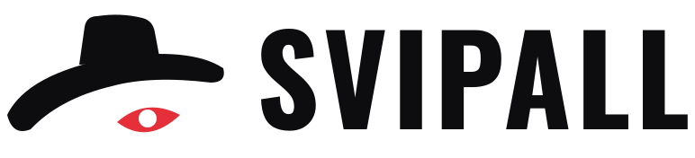

# Svipall brand

The symbol is Odin travelling in disguise. His broad hat is pulled low over the side where he gave his eye, and the other eye watches from under the brim. Svipall is one of his names ("the one who changes"), and the tool shows each site a different face that still holds together.

`brand-book.html` shows every version and piece in context.

## Files

| Path | Use it for |
|---|---|
| `logo/svipall-symbol.svg` | Master symbol in one ink (`currentColor`); the eye is marked `data-ink="accent"` |
| `logo/svipall-symbol-small.svg` | Small cut for anything under 64 px: thicker brim, larger eye, the pupil still open |
| `logo/svipall-symbol-color.svg`, `-on-dark.svg` | Symbol on light and dark grounds (`-small-` variants too) |
| `logo/svipall-symbol-black.svg`, `-white.svg` | One-ink symbol |
| `logo/svipall-horizontal*.svg` | Symbol and name side by side: colour, on dark, black, white |
| `logo/svipall-horizontal-small*.svg` | The same lockup with the small cut, for lockups under 64 px tall (navigation bars, README headers) |
| `logo/svipall-stacked*.svg` | Name under the symbol: same four versions |
| `logo/svipall-wordmark.svg` | The name alone, as outlines (`currentColor`) |
| `logo/png/` | Symbol at 64 to 1024 px and horizontal lockup at 800 and 1600 px, transparent |
| `web/` | `favicon.svg`, `favicon.ico` (16, 32, 48), app icons, `og-image.png`, `site.webmanifest`, and `head-snippet.html` with the tags to paste |
| `social/` | GitHub, X, Bluesky, Mastodon, Discord, Reddit and Product Hunt avatars and banners, at each platform's size |
| `motion/svipall-animated.svg`, `-on-dark.svg` | The hat comes down and the eye opens, about 1.1 s; respects reduced motion |
| `tokens.json` | Colours, fonts and logo rules as data |

The older files directly in this folder (`svipall-hero-*`, `svipall-lockup*`, `svipall-mark*`, `svipall-wordmark*`, `svipall*.png`) belong to the previous logo. The README or the site may still link to them, so check before removing any.

## Colour

| Name | HEX | RGB | Use |
|---|---|---|---|
| Alert red | `#E5303A` | 229 48 58 | The eye and accents. The hat is never red |
| Dark red | `#C81E2D` | 200 30 45 | Red text and links on paper |
| Ink | `#0D0D0F` | 13 13 15 | The hat, the name, dark grounds |
| Paper | `#F3F1EF` | 243 241 239 | Light grounds |
| Survey grey | `#8A8784` | 138 135 132 | Coordinates and captions on ink |

Contrast ratios:

- ink on paper 17.2:1
- red eye on paper 3.9:1 and on ink 4.5:1, enough for graphics (3:1) but not for small text
- dark red on paper 5.1:1, for text
- ink on red 4.5:1
- white on red 4.4:1, so no small white text on red
- grey on ink 5.4:1

## Type

- **Name:** Oswald 700, capitals, tracking +0.04 em. In the logo files it is already outlined.
- **Text:** IBM Plex Sans.
- **Code:** IBM Plex Mono.

All three are free on Google Fonts under the SIL Open Font License.

## Which version where

- Light grounds: the colour files, with an ink hat and a red eye.
- Dark grounds and photos: the `on-dark` files, with a paper hat and a red eye.
- One ink only (engraving, stamps, monochrome UI): the black or white files, or the `currentColor` master. The eye takes the hat's ink and still reads as its own shape.
- From 64 px up, use the main symbol. Under 64 px, use the small cut, in lockups as well as alone. Both keep the pupil open, so the mark still reads as an eye.

## Clear space and size

- The unit **u** is the height of the eye (42/256 of the symbol). Keep at least u free on every side of any lockup.
- The minimum size is 16 px, with the small cut.

## Don't

- colour the hat red, or the eye anything but alert red (or the single ink)
- stretch, rotate, outline or add shadows or gradients
- set the name in another font or retype it in place of the outlines
- put the symbol on a ground where the eye falls under 3:1

Before public use, run a trademark search: hat marks are common.

Identity made with [kothar](https://github.com/ilien-dev/kothar).
